  

 →  →  →  →  →  → 

---

Currently taking **, not an **. Fulfilling my dreams of finally being able to customize software to how I use it.

Data Science brings together areas that were traditionally studied separately:    

---
Watch this: [I Went Back to Coding School. AI Already Won.](https://www.youtube.com/watch?v=HvDuaO_PtPs&t=1s)

---

Currently exploring and building:
1. **Local AI & Large Language Model Systems**
   - Running and experimenting with local LLMs
   - AI agents, automation workflows, and knowledge systems

2. **Generative AI & Creative Technology**
   - ComfyUI workflows
   - AI-assisted video & illustration pipelines

3. **Data Science & ML Projects**
   - Data-driven decision systems
   - Statistical analysis

4. **Big Data, Data Engineering & Analytics**
   - Cloud & On-Prem pipelines
   - Data processing workflows

5. **Web Applications & Automation**
   - Full-stack applications (eg Paid Microsoft Store Apps)
   - Workflow automation with AI assistance

6. **Hardware & Engineering Experiments**
   - Embedded systems
   - IoT, Electronics and maker projects

### 📚 [My Book List](https://github.com/jbgithub22/my-book-list/tree/main)

### ✨ [Support My Work](https://github.com/vectorforge22/support)

---

 \
*excludes Jupyter Notebooks, HTML, CSS, Powershell and TeX.

<!--
### Hi there 👋

#### 🔭 I’m currently working on Machine Learning projects and getting familiar with datasets from various domains.

#### 🌱 I’m currently learning Python ML Libraries and Back-end Cloud Development.

#### ⚡ Summary of projects I've done:
- TrueNAS Home Server
- OpenSEA NFT Collection
- Ender 3 Pro 3D Printer (Modded)

**jbgithub22/jbgithub22** is a ✨ _special_ ✨ repository because its `README.md` (this file) appears on your GitHub profile.

Here are some ideas to get you started:

- 🔭 I’m currently working on ...
- 🌱 I’m currently learning ...
- 👯 I’m looking to collaborate on ...
- 🤔 I’m looking for help with ...
- 💬 Ask me about ...
- 📫 How to reach me: ...
- 😄 Pronouns: ...
- ⚡ Fun fact: ...
-->
